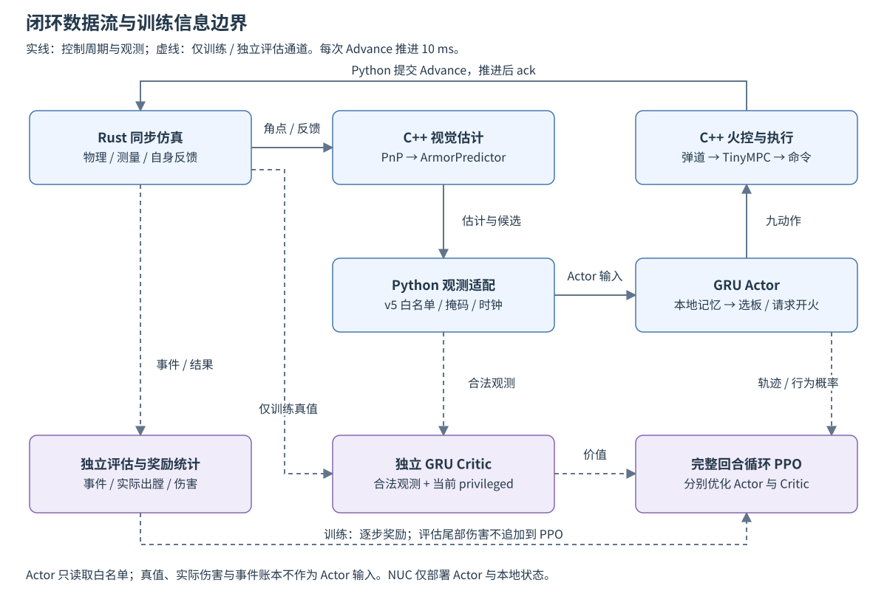

# 架构与代码职责

本项目把物理推进、视觉火控、策略推理和训练优化分开。服务器运行完整闭环；部署时仅将 Actor 及其输入、状态契约交给 NUC。当前训练采用持续记忆 GRU，旧 MLP 通过独立兼容路径读取。

## 当前闭环

图 1：控制观测通过视觉估计和 v5 白名单进入 Actor；仿真真值只进入独立 Critic 与评估通道。虚线表示仅训练或评估使用的数据。图中 PPO 接收的奖励只包含训练窗口内逐步奖励，独立评估尾部伤害不回写训练。

[Mermaid 图源](figures/control_loop.mmd) · [生成与维护](figures/README.md)

无渲染模式生成带噪二维角点，随后使用真实 PnP 和预测器。它不运行图像检测网络，也不把真实目标位置直接当作预测器输出。带图像的 Talos/视觉主程序是另一条链路，不由当前 Python 会话启动。

## 运行库与训练层

| 模块 | 职责 |
| --- | --- |
| [transport/client.py](../src/transport/client.py)、[processes.py](../src/transport/processes.py) | 仿真事务编号、未确认请求重取、独立 socket 与进程回收 |
| [transport/vision_bridge.py](../src/transport/vision_bridge.py) | JSONL 交互、同周期策略询问与动作提交、发布确认 |
| [environment/warmup.py](../src/environment/warmup.py) | 禁射搜索、连续新图像帧确认与超时 |
| [environment/fire.py](../src/environment/fire.py)、[multi_robot_fire.py](../src/environment/multi_robot_fire.py) | Gym 采样、物理资源、奖励与回合边界 |
| [policy/recurrent_observations.py](../src/policy/recurrent_observations.py) | v5 单步输入、重置事件和候选槽位映射 |
| [policy/recurrent_actor.py](../src/policy/recurrent_actor.py) | 目标、候选、云台与资源 GRU；选板和条件开火头 |
| [training/recurrent_policy.py](../src/training/recurrent_policy.py) | 独立 Critic 及仅训练可见的真值编码 |
| [training/recurrent_rollout.py](../src/training/recurrent_rollout.py) | 独立 worker、完整回合采集与更新屏障 |
| [training/recurrent_ppo.py](../src/training/recurrent_ppo.py)、[sequence_storage.py](../src/training/sequence_storage.py) | 序列重放、预热、循环 PPO 和分块存储 |
| [training/curriculum.py](../src/training/curriculum.py)、[curriculum_evaluation.py](../src/training/curriculum_evaluation.py) | 课程版本路由、固定场景、晋级与复核 |
| [training/models.py](../src/training/models.py)、[runtime.py](../src/training/runtime.py) | 契约与指纹、检查点、长期保存和有界诊断 |
| [training/offline_evaluation.py](../src/training/offline_evaluation.py)、[scoring/window.py](../src/scoring/window.py) | 共同离线评估、按实际出膛窗口归属计分 |
| [policy/recurrent_deployment.py](../src/policy/recurrent_deployment.py) | Actor 导出、校验、本地状态管理与延迟记录 |

## 一个控制步如何完成

`reset()` 完成禁射预热后进入训练模式。`prepare()` 在当周期策略回调处暂停并返回观测；`step(action)` 通过 `submit()` 恢复同一次控制计算，提交命令、推进 10 ms 物理时间，再确认发布。无回调时仍提交已计算的禁射命令并推进物理，不跳过该周期。准备观测本身不推进世界；取消未提交周期后必须 Reset。

每个控制步更新一次 GRU。射击机会由独立的 50–100 ms 时钟门控，非到期步仍可选板和跟踪。回合重置清全部隐藏状态；目标代次重建或首次进入完整 LOST 时清目标与候选状态，短暂遮挡但跟踪状态仍保留时继续更新。具体输入与状态形状见[持续记忆 GRU](persistent_gru.md)。

训练器让每个环境至少采集 `ppo.n_steps=512` 步，并完成当前回合后暂停。全部 128 个环境到达边界才统一更新，下一批回合使用新权重。实际样本数取决于完整回合长度，`512 × 128` 只是采集下限。序列长度 128、预热最多 32 步，每批 64 个片段；完整回合在 CPU 保存，小批次送入计算设备。

自然终止的价值自举为零；时间截断使用旧回合真实末观测和该回合 Critic 状态。训练奖励只包含实际发生的伤害及配置成本，不追加评估尾部伤害。独立评估关窗后自然结算在途弹丸；`EvaluationSession` 接管进程后，外部不得另行推进仿真或桥接。

## C++ 桥接

| 文件 | 作用 |
| --- | --- |
| [bridge.cpp](../native/vision_bridge/bridge.cpp) | 处理 JSONL 操作，适配检测、反馈和裁判，调用视觉核心并输出命令 |
| [policy_wire.hpp](../native/vision_bridge/policy_wire.hpp) / [policy_wire.cpp](../native/vision_bridge/policy_wire.cpp) | 序列化策略观测和解析同步动作应答 |
| [CMakeLists.txt](../native/vision_bridge/CMakeLists.txt) | 从 `VISION_ROOT` 编译 PnP、预测器、火控、轨迹规划及 TinyMPC |

桥接不需要相机 SDK 或 OpenVINO 检测推理，但需要 OpenCV、Eigen、Ceres 等依赖。视觉源码改变后，需要重新构建桥接才能使用新实现。

比较传统火控时使用独立目标 `rmvision-rule-bridge`，其 RulePolicy 与模型使用共同射击机会时钟。原生回放诊断由 `replay_diagnostics.cpp/.hpp` 提供。

## 时间与信息边界

| 子系统 | 当前节拍 |
| --- | --- |
| 控制与 Advance | 10 ms / 100 Hz |
| PPO 新训练射击决策 | 默认随机 50–100 ms，独立时钟门控；原控制步不变 |
| 物理 | 默认 1 ms、2 子步；训练入口支持 0.5/1/2 ms |
| 云台积分 | 最多 1 ms 积分间隔 |
| 合成检测 | 30 Hz，按物理步边界采样 |
| 自身裁判 | 10 Hz，包含独立采样时间 |
| 自身武器机械状态 | 每物理步更新，每控制步读取；独立于裁判采样 |

训练推进使用仿真时间；等待 Python 策略时世界不继续演化。资产加载和通信超时仍使用宿主机时间。反馈合成时间戳为 `10^18 + 回合仿真纳秒`，不能当作真实日期。控制会复用最近估计，没有新检测帧时不重复更新预测器。

策略输入来自目标估计、自身反馈和自身裁判数据。种子、实验倒计时、真实目标状态、实际伤害和完整事件账本不送给策略。`EvaluationSession.advance()` 的完整返回对象包含评估真值，不能整体作为网络输入。

旧观测路径的 Python 仅合并自身武器通道的机械间隔、供弹忙和枪口无效三个位，避免把 50 ms 的机械冷却锁在 100 ms 裁判采样周期里。热量、生命和弹量继续使用裁判快照；物理后端仍最终裁决每次出膛。合成检测的整板可见性测试排除小弹丸，防止开火本身造成系统性的虚假暂时丢失。

`self_weapon` 机械状态合并属于旧观测路径。当前非对称 v4/v5 路径以 Actor 可知的热量、额度、有效性及本地时钟生成限制，不读取即时仿真综合许可；物理后端仍裁决实际出膛。

双方底盘可执行静止、旋转、平移和复合脚本，通用环境另支持特定机构/地形模板；课程只启用其中一部分。合成可见性近似及部署边界见[开发状态](development.md)。

## 工具依赖与兼容路径

`tools/training/` 单向依赖运行库和训练接口，`src/training/` 不导入工具。课程内验证和最终测试由训练器执行；工具另行生成报告、诊断或回放。当前工具入口见[辅助工具](../tools/README.md)。

旧 MLP 使用 `MaskablePPO`、短历史观测和 SB3 向量环境；该路径的 `n_steps × n_envs` 固定 rollout 语义不适用于完整回合 GRU。历史结构与动作概率契约见[历史接口](legacy_interfaces.md)。
