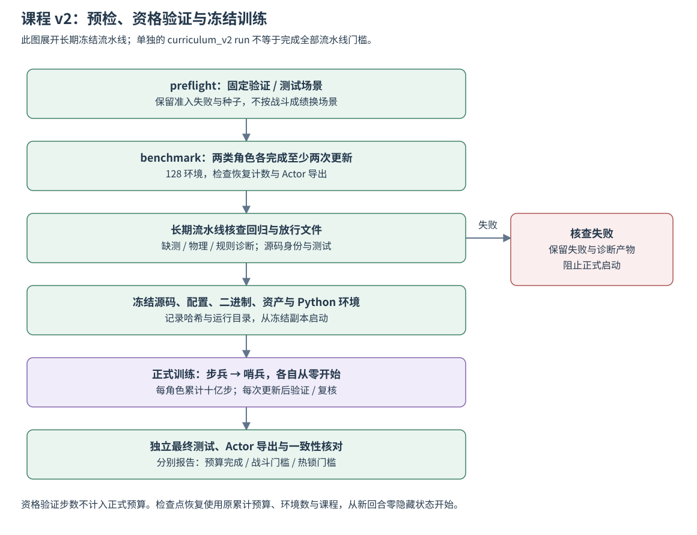

# 课程 v2 与热锁奖励

服务器负责仿真、视觉估计、采集、PPO 更新、评估和导出；NUC 仅部署 Actor。
步兵和哨兵分别从零开始，每类累计 1,000,000,000 个训练步，128 环境，顺序训练。
验证、预检和资格验证步数不计入正式预算。本页描述 v2；[v3](curriculum_training_v3.md)扩展平移分层与准入，须显式选择。历史 v1 训练产物保留在 `artifacts/`，当前代码不支持恢复 v1 课程。

## 课程

晋级依据是固定场景上的战斗指标。击毁率为击毁场景数／场景数，命中效率为窗口归属的有效伤害弹数／实际出膛弹数；聚合时先求弹数总和再相除，零发射取 0。场景失败不能当作零伤害的正常完成，具体失败处理见评估结果。

阶段顺序为 C0、C1、C2、C3、C5、C8-R1、C8-R2、C8-T1、C8-T2、C8-D1、C8-D2、C8-M。
四种目标几何从 C0 开始等比例混合，机构姿态固定；车型、运动方向、距离、角色分开采样。
C0–C5 为 350 HP 步兵靶，C8 步兵/哨兵靶各半。自车始终为标准几何。

| 阶段 | 难度 | 击毁率 / 命中效率 |
|---|---|---|
| C0 | 静止，3–5 m | 90% / 80% |
| C1 | 慢转 0.5–1 rad/s | 90% / 70% |
| C2 | 旋转 1–3 rad/s / 平移 0.2–1 m/s，各半 | 85% / 70% |
| C3 | 上述旋转和平移同时发生 | 80% / 65% |
| C5 | 自车旋转、平移、复合各三分之一 | 80% / 65% |
| C8-R1/R2 | 旋转 3–5 / 5–7 rad/s | 80% / 65% |
| C8-T1/T2 | 平移 1–1.5 / 1.5–2 m/s | 80% / 65% |
| C8-D1 | 2–3 / 5–6.5 m，各半 | 80% / 65% |
| C8-D2 | 6.5–8 m | 80% / 65% |
| C8-M | 最多同时两项高级因素 | 75% / 60% |

目标高速平移振幅 1–1.5 m，其余 0.5–1 m。C5 自车角速度 0.3–1 rad/s、平移 0.2–1 m/s。
C8-M 四类模板等比例：高速旋转+高速平移、自车运动+一种高速目标运动、扩展距离+一种高速目标运动、自车运动+扩展距离。
C4 停用；人工遮挡只做回归；隧道出洞交战独立调试；轮腿上台阶在 v2 课程中停用。

每阶段 40 个固定验证场景和 40 个独立最终测试场景。主要子类和每种车型分别检查门槛。
采样为当前阶段 70%、旧阶段 30%；旧阶段份额一半均分，一半按战斗指标缺口分配。
连续三次通过当前阶段、同模型旧阶段复核全部通过后晋级。晋级时热锁不作为阻断门槛。
全部通过后每 500 万步全量复核；退步时逐更新检查薄弱阶段，每五次更新全量复核，恢复三次连续通过后回到定期复核。

## 奖励及物理统计

每个控制步的训练奖励为：

```text
r_t = 0.05 D_t - C_selection,t - 2 ΔN_ordinary_only,t
      - 10 ΔN_round,t - 0.2 ΔT_locked,t
```

`D_t` 是本步实际伤害；`ΔN` 是接管后物理累计热锁次数的本步增量；`ΔT_locked,t` 是普通/整局锁定并集时长的增量，单位 s。系数分别按每次触发或每秒计费。`C_selection,t` 包含确认切板成本、快速返回成本和命中朝向差距成本，来自动作前视觉估计，定义见[选板奖励实现](../src/training/selection_reward.py)：

```text
q_i = max(0, cos(theta_i))²
C_switch = 0.002                         # 有效旧板之间的确认切换
C_return = 0.03 max(0, 1 - age_B/0.1)²   # A→B→A，age_B 单位 s
C_facing = 0.1 × 0.01 × max(0, best_valid_q - selected_q - 0.1)
```

`theta_i` 为候选板预测命中时刻朝向；未选板质量取 0。非可靠 tracking、目标重建或无有效上下文时不计相应成本；首次选板和旧板失效不收切板成本。奖励分项与实际伤害分开记录。

物理热锁计数由仿真提供，使用接管后的累计计数差，不依赖 Actor 的 10 Hz 反馈。
同一物理事件同时触发普通和整局热锁时只收整局触发成本；重叠时长只计一次。
只有高热量、被拒绝请求和预热历史不会额外产生此惩罚。回合结束后不补算虚构时长。

训练配置新增可选 `thermal_reward`，三个非负系数为 `ordinary_onset`、`round_onset`、`locked_per_s`。
省略该配置保持旧奖励。物理资源新增 `ordinary_heat_lock_count`、`round_heat_lock_count`、`joint_heat_lock_count`，旧合并计数保留。
Gym info 的 `physical_thermal` 与奖励分项属于训练/评估通道，不加入 Actor、动作掩码或网络输入。
最终逐阶段要求无新增整局热锁，普通热锁回合比例不超过 5%。战斗、热锁和预算完成状态分开报告。

## 场景准入

仿真对完整规定路径采样检查碰撞与支撑。v2 另检查 30 s 中心视线相对自车的角速度窗口，至少存在一秒不超过云台 3 rad/s 的窗口。
显式 `Inspect` 增加只读 `evaluation.fireability`：当前真实相机几何、枪口、静态装甲中心低弧弹道及遮挡。
弹道探针使用配置中的重力、阻力、风、标定弹速和 1 ms 积分；它是静态中心线几何诊断，不是运动目标未来命中保证。
至少一块当前真实可见装甲须有可解、无遮挡的枪口路径。探针不推进时钟、不消耗传感器随机流，也不加入控制步网络输入。
冻结后不替换合法失败场景。传统火控仅用于诊断、实际命中验证和对照，不用其命中率筛掉困难场景。

出生准入包含物理路径检查、碰撞体同步及初始瞄准后的再次路径检查、视觉预热。
初始路径无碰撞不代表预热期间转动的云台也有足够净空。未冻结的随机训练场景若在
`reset()` 预热期间报告 `runtime collision:`，记录该尝试的场景、种子和原因后重新采样姿态，
最多 32 次；拒绝记录随最终回合汇总保留。冻结验证场景发生同样错误仍直接报告失败。
策略接管后的 `step()` 碰撞以及传输等其他错误继续中止，不静默重采样，不修改物理碰撞规则。

## 长期训练

128 环境各至少 512 步，完成当前回合后暂停，所有环境到边界才更新。
完整回合留在 CPU，小批次只搬运最多 32 步预热加 128 步训练片段；每批 64 个片段。
每 epoch 分块重放刷新起点隐藏状态，只缓存需要的状态。PPO 的行为概率、旧价值、优势、回报固定，填充步不推进状态、不参与损失。
保持原 PPO 系数、10 ms 控制周期和物理步长，不使用多 GPU 或网络结构变更。

可选 `runtime` 配置启用分块数据、有限诊断与长期保存。每次更新保存原子检查点，最近三份滚动保留；每跨越 1000 万步和阶段晋级永久保存模型及 Actor。
每批最多抽样八条完整轨迹，诊断随机流独立。完整回合汇总与验证指标永久保留，详细轨迹上限 50 GiB。
磁盘不足 50 GiB 时在批次边界保存并退出；不清理旧实验。恢复使用累计预算、原场景清单和指纹，从新回合零状态开始。

## 发布与训练流程



图 3：完整冻结流水线在资格验证后核查回归、放行文件和源码身份，再复制运行副本。正式训练的步兵与哨兵分别从零开始；资格验证更新不计入正式预算。直接调用 `curriculum_v2 run` 的训练入口与 `curriculum_v2_pipeline` 的完整发布核查应分别理解。

依据：[v2 课程入口](../tools/training/curriculum_v2.py)、[冻结流水线](../tools/training/curriculum_v2_pipeline.py)。[Mermaid 图源](figures/curriculum_v2_release.mmd)。

## 运行

本页使用步兵、哨兵两份 `rmul_2027_{infantry,sentry}_curriculum_v2.json`。
`python -m src.training.train` 默认读取步兵 v2，哨兵通过 `--config` 显式选择；
二者分别训练和保存。恢复使用原累计目标和环境数，不追加预算。

进入服务器项目目录，先加载现有 Rust 运行环境，再设置一张空闲 GPU 的 UUID：

```bash
export CARGO_HOME=/data/prototype956/rm_vision/gru-work/cargo
export RUSTUP_HOME=/data/prototype956/rm_vision/gru-work/rustup
export PATH="$CARGO_HOME/bin:$PATH"
export CUDA_VISIBLE_DEVICES=<空闲GPU的UUID>
```

各命令的输出目录必须是新目录：

```bash
.venv-gru/bin/python -u -m tools.training.curriculum_v2 preflight --output artifacts/training/<预检目录>
.venv-gru/bin/python -u -m tools.training.curriculum_v2 benchmark --scenarios artifacts/training/<预检目录> --output artifacts/training/<资格验证目录>
.venv-gru/bin/python -u -m tools.training.curriculum_v2 run --scenarios artifacts/training/<预检目录> --output artifacts/training/<正式目录>
```

`benchmark` 顺序执行两类模型各至少两次 128 环境更新，并检查恢复计数和独立导出。
`run` 顺序完成两类正式预算。进度见顶层 `status.json`、各角色 `run.json` 和 `logs/progress.csv`。
恢复单个角色使用 `src.training.train --resume <检查点> --output-dir <新目录>`，不会重新追加十亿步。
NUC 接收通过验证的 Actor 到独立版本目录，保留旧默认模型，CPU 推理 P99 目标为 10 ms。

## 冻结运行与中断恢复

正式流水线由 `tools.training.curriculum_v2_pipeline` 执行。它等待两类 128 环境资格验证、缺测与物理回归、放行文件通过，再检查源码哈希，复制源码/配置/二进制/资产及 Python 环境到独立 `-runtime` 目录。
正式训练从冻结副本运行；原工作目录可以继续编辑。实际运行根目录、GPU UUID、源码/资产/二进制哈希保存在同名 `.sources.json`，流水线状态保存在 `.pipeline.json`。

验证权重使用字节载荷传给进程池，不使用大量共享 Tensor 文件句柄。每次完整优化在验证前另存 `updated-pending-validation.zip`；恢复此文件会先完成该次验证，再采集新回合。
恢复时应使用 `.sources.json` 记录的 Python 和运行目录，保持原配置、场景与累计预算。不要以当前工作目录的新代码直接覆盖冻结运行副本。

Actor 的部署清单保留 v5 输入与状态接口，并从模拟部署配置移除服务端课程、热锁奖励及日志调度；NUC 的独立闭环只测试本地 Actor 推理。两类资格模型的部署结果与最终十亿步模型的部署结果分别保存，均不自动替换默认模型。

## 全交战云台净空与接触限位

出生后计算上部结构碰撞体的保守扫掠包络，覆盖云台转动与规定的底盘路径。
包络只能证明外部空间充足，不能把靠近障碍物但仍可交战的固定场景自动替换掉。
实际执行器始终在物理步内检查关节转动的完整弧线；角度分段配合几何半径余量，
在接触前截短该步运动，并将已接受姿态、零接触末速度写回执行器状态和反馈。
无接触时直接保留原执行器旋转值，不引入额外归一化或速度重置。

`feedback.saturation_flags` 的第 7 位（128）表示结构接触限位；评估通道新增
`evaluation.gimbal_structure_contact`（受限步数、最近障碍物）。这些数据不扩展 Actor 输入，
不参与动作掩码，也不改变策略采样动作。开火请求在物理姿态应用后处理，枪口使用实际姿态。
出生准入中的真实碰撞、不可行底盘路径、传输错误和其他运行时错误仍明确报告。

修复原生几何实现后恢复旧检查点，使用 `tools.training.checkpoint_migration clearance` 显式迁移。
它只放行列出的原生碰撞修复文件、原生二进制及运行目录位置变化；观测、网络、Python 训练代码、
视觉、奖励、课程、预算和 PPO 参数必须一致。`recurrent.pt` 整个字节载荷保持一致，
同时保留优化器、随机流、课程状态、工作进程回合计数和原固定场景清单，并输出哈希收据。

历史固定步数恢复流水线已移除。恢复已有实验时，先按实际修复类型使用统一迁移入口，
核对迁移收据后通过 `src.training.train --resume <迁移检查点> --output-dir <新目录>` 继续原累计预算。
旧冻结运行副本及其验收产物保留各自的历史实现，不作为新实验的通用启动入口。


课程定义与阈值以[实现](../src/training/curriculum_v2.py)和运行保存的场景清单为准。本页规定训练与验收方法，没有给出当前模型已完成十亿步或已通过全部阶段的结论。
