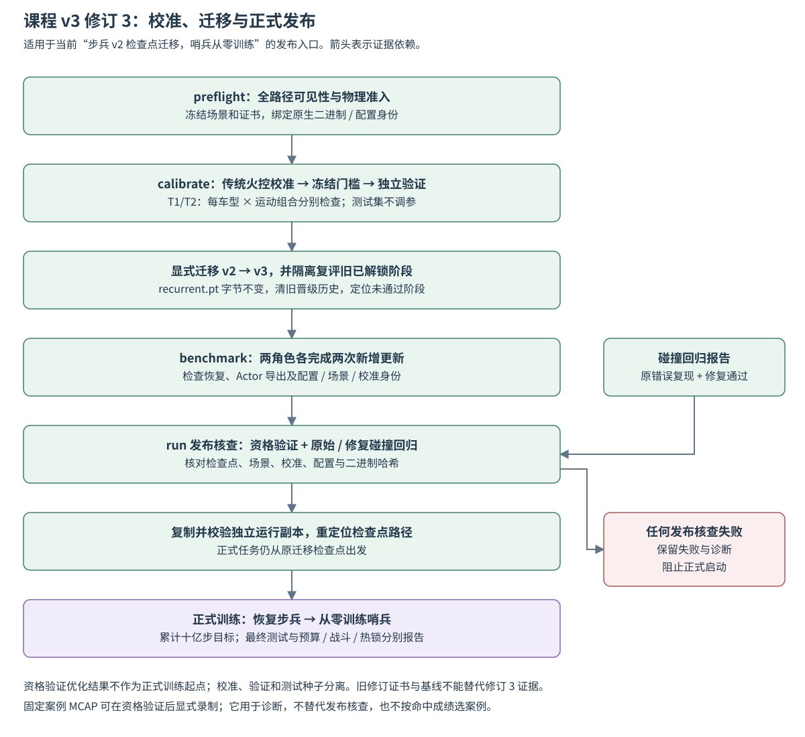

# 课程 v3：平移分层与传统火控基线

v3 只重设 C8-T1/T2 的任务分层和门槛；修订 3 对全部课程加入原地图全路径无遮挡准入，其他阶段保持原难度、场景数量与门槛。
保留 v2 配置、读取和回放，不就地修改旧实验。正式切换必须先通过场景预检、
传统火控校准及独立验证、碰撞回归、两类角色的 128 环境资格验证。

本页描述实现与发布条件；具体运行是否通过须核对对应预检、校准、资格验证和最终测试产物。基础阶段及奖励见[课程 v2](curriculum_training_v2.md)。

## 场景与难度

运动路径独立于目标装甲朝向。可选 `motion.translation_heading_rad` 为 Bevy 世界系
绕 +Y、从 +X 起算的弧度；路径轴为 `(cos(h), 0, -sin(h))`。
省略字段时仍使用初始车体局部 +X，不改变旧场景轨迹。
路径、出生准入和可跟踪性检查使用相同定义，课程标签及真值不加入 Actor 输入。
新平移课程在 12×8 m 场地内采样双方共同出生平移，先按完整平移路径包围盒预留 0.6 m 边界，
保持距离、夹角和运动参数；实际碰撞、支撑和可见性仍由原生准入检查决定。
修订 1 的 T1/T2 搜索上限为 128 次、其他阶段为 32 次；修订 2 统一支持至多 128 次出生姿态搜索。冻结之后始终只有一次精确准入，
不因战斗成绩重选场景。

T1/T2 内按径向 20%、斜向 30%、横向 50% 采样；路径与初始视线的锐角分别为
`[0,20)`、`[20,60)`、`[60,90]` 度。T1 速度 1–1.5 m/s、振幅 1.5–2 m；
T2 速度 1.5–2 m/s、振幅 1–1.5 m。对振幅 A（m）、峰值速度 v（m/s）的正弦路径，峰值加速度为 `v²/A`（m/s²）。
当前阶段／旧阶段仍为 70%／30%，奖励、网络、10 ms 控制周期和射击机会时钟保持原设置。

发布修订 1 保留每角色、每个 T1/T2 阶段各 96 个场景，兼容原有回放。
发布修订 2、3 均对每角色、每个 T1/T2 阶段生成 384 个校准、384 个验证、384 个测试场景；当前配置为 `release_revision: 3`。
四车型 × 三运动类型的每个组合 32 例，覆盖两类目标角色、两个运动方向和两侧夹角，各组合独立重复四次。
修订 2 保留修订 1 首批 96 例的参数与种子，新增案例只扩展采样，不按成绩挑选。
校准、验证、测试种子分离。合法性冻结之后不按战斗成绩替换困难场景。

## 修订 3：原地图全路径无遮挡

所有课程描述显式设置 `scenario.visibility_admission: "full_path_clear"`。省略该字段保留旧重置行为，未知值拒绝。
准入读取真实装甲和碰撞体快照，虚拟执行双方 static/translation/rotation/combined 运动程序，覆盖重置起 45 秒；不推进物理时间或测量 RNG。
当前课程没有 lift/climb/jump/tunnel；这些运动遇到本准入规则时明确拒绝，不作不受支持的全路径承诺。

每个区间至少一块装甲朝向相机、中心及四角满足视场和遮挡条件；允许换板。
检查理想瞄准、真实相机安装偏移在区间内的位置包络及机械俯仰范围，不依赖 GRU/传统控制器的输出。
最多 10 ms 区间使用速度/角速度界构建凸视线体，包住区间内的所有视线；无法证明时细分至 1 ms，仍不确定则拒绝。
目标自身装甲/核心仍参与遮挡，保持实时测量使用的 1 cm 末端皮肤容差；准入不关闭任何运行时遮挡或碰撞。
无遮挡表示存在可观测条件，不承诺实际控制器不失锁、不出视野或命中。

`preflight --legacy-scenarios <修订2预检目录> --renew-invalid-placements` 逐例重检全部旧冻结场景，几何失败才重新搜索出生。
保留旧/新描述及失败原因，并比较任务难度签名；速度、振幅、车型、角色、距离和分层不得变化。
128 次几何出生搜索耗尽直接失败。修订 3 的预热跟踪失败直接报告，不通过重选姿态筛掉估计器困难案例；冻结后的控制阶段错误同样不重采样。

对部分通过的修订 3 预检，可用 `repair` 仅修复失败清单中的案例。已通过描述（包括出生、证书、检查耗时）按内容哈希逐项保留，不重新运行或重写证据；失败案例仍保留原种子和全部难度参数。
显式 `placement_search` 标记启用 `rmul_floor_clearance_v1`：独立的确定性随机流平移、旋转相对任务，利用 32768 个低差异粗候选覆盖地图，优先选择机器人往返路径与视线区域避开高地、桥区、工作台的姿态。
地图矩形来自原生 `field.rs` 的地面区域，只用于候选排序；粗筛有重叠的候选仍保留作后备，不能据此判定场景无解或签发准入。
最多提交 128 个候选给未修改的原生准入，必须取得实际碰撞体、相机及完整 45 秒区间检查的证书。T1/T2 车体朝向独立采样，平移方向随视线旋转，保留原夹角、侧向和前后方向。
`repair-summary.json` 汇总修复数量，`repair-audit.json` 保存旧/新描述，`<role>/preserved.json` 列出保留案例哈希；任一预热或控制错误明确失败，禁止按跟踪或战斗表现重试。
旧案例与旧回放不自动添加该标记。修订 3 的 T1/T2 随机训练在课程调度器中显式添加该标记，复用同一候选生成器；其余课程保留原来独立重采样朝向的生成方式，避免双方运动时整体刚性变换无法修正相对路径互撞。全部课程仍要求完整无遮挡准入。课程抽样和种子随机流保持不变，采样器身份纳入课程指纹，缓存仅保留最近两组候选以限制 128 环境内存占用。冻结题库仍按原描述运行，修复产物必须另行通过基线和训练恢复门禁。

成功证书保存在冻结描述 `visibility_certificate` 和评估结果中，绑定场景、原生二进制和仿真配置 SHA256；包含算法指纹、区间数、时长和最少可见装甲数。
旧修订证据和旧基线不可用于发布修订 3。`calibrate` 和正式发布检查全部集合证书与实际运行身份，之后重新进行传统校准及独立验证。
证据只用于场景管理和独立诊断，不增加策略观测；MCAP `/replay/info.scene.visibility_certificate` 及 `/replay/physical` 保留证据，分析器 inspect/preset 展示准入信息。

## 计分与晋级

传统控制复用独立构建目标 `rmvision-rule-bridge`，使用完整原生 RulePolicy 和共同射击机会时钟。
训练桥接二进制不接受比较专用的规则模式和时钟控制字段。
传统控制、Checkpoint、Actor、v3 验证与 Foxglove 回放复用同一离线评估器。

接管后至多射击 30 秒，提前结束时关闭窗口；随后禁止新射击，以至多 1000 个结算步
自然结算在途弹丸。按实际出膛时间归属窗口，使用有效伤害弹数／实际出膛弹数计算命中效率。
窗口奖励和尾部伤害分开保存，尾部伤害不追加到 PPO 训练奖励。
零发射效率为零；预热错误、环境错误及结算不完整均不能通过晋级。

令 H 为组合内有效伤害弹数之和／实际出膛弹数之和，K 为击毁场景数／场景数；baseline 表示独立校准集的传统火控值。每个车型／运动组合要求 `H >= 0.90 * H_baseline`、
`K >= min(0.80, max(0, K_baseline - 0.10))`，十二组合全部通过。
校准集任一组合没有发射、有效命中、击毁，或有运行错误／结算不完整时，校准失败。
门槛冻结后再跑独立验证集；传统火控未达标则阻止发布，不自动降低门槛，不使用测试集调参。
校准文件包含逐组合基线、要求、场景与源码／配置／二进制身份，加载时验证哈希。

2026-10-29 用户明确授权了一次历史基线发布例外：仅步兵 C8-T2 的 wheel_leg/oblique 组合，实测命中55.4419%低于要求59.2849%，击毁96.875%高于80%。原始47/48通过结果保持不变，全部场景、校准值和模型晋级门槛不变。
`tools/training/curriculum_v3_release.py` 将例外绑定到本次原始门禁与校准文件的完整哈希；授权收据和原始门禁JSON内嵌在发布报告中，状态为`approved_exception`。它拒绝额外失败、击毁率失败、无效/缺失案例、身份不匹配及任何阈值变化，不提供通用跳过检查开关。此例外只允许继续迁移和其余恢复门禁，不能将失败组合标记为通过，也不影响模型仍须通过全部十二组合的要求。

T1/T2 至少三次验证，最近三次至少两次通过且最新一次通过；其他阶段连续三次通过。
旧课程复核、掌握后定期复核和热锁独立报告继续保留。

## 出生安全与恢复

脚本底盘运动可能把已经转向的上部结构带入路沿，当前姿态下的云台接触限位无法保证
后续根节点路径安全。己方旋转、平移、复合运动必须在接管前获得完整路径的扫掠净空证明。
证明失败的随机出生记录后重采样；冻结场景明确报错，不在接管后换场景，也不忽略真实碰撞。
当前修订只要求移动受控机器人具有自身的完整扫掠净空；非受控目标的任意云台姿态不额外作为环境准入条件，
其真实脚本路径和双方包络接触检查仍保留。
显式 `preflight --renew-invalid-placements` 会保存旧冻结几何失败，按原种子、角色、速度、振幅和课程类型重新搜索合法出生姿态；
修订 3 只允许接管前的几何失败进入该流程；跟踪预热初始化失败直接报告，战斗成绩失败不触发替换。
每个 worker 保留最近接纳场景，便于在有界日志下复现错误。

v2→v3 使用显式迁移工具，`recurrent.pt` 字节保持一致：Actor、Critic、优化器、训练随机状态
及累计步数不变。保留 worker 回合计数；清空旧晋级历史并隔离复评 C0 至旧当前阶段，
定位最早未通过阶段。全部通过则留在旧当前阶段，此次只计一次 v3 验证。
迁移不放行观测、动作、奖励、PPO 参数或预算变化，保留来源哈希和允许的源码差异审计。

## 发布流程



图 4：传统火控先在校准集产生门槛，再用独立验证集检验；迁移检查点随后用于资格验证。正式发布合并资格验证和碰撞回归证据，核对运行身份并冻结副本，仍从原迁移检查点启动步兵训练。资格验证得到的优化权重不作为正式起点，哨兵随后从零训练。

依据：[v3 发布核查与编排](../tools/training/curriculum_v3.py)、[运行副本冻结](../tools/training/curriculum_v3_release.py)。[Mermaid 图源](figures/curriculum_v3_release.mmd)。

## 命令

在具备 Rust、PyTorch、仿真资产和 C++ 依赖的 Linux 服务器运行，显式设置空闲 GPU，
并加载已有 Rust 工具链环境。所有输出目录必须为新目录。

```bash
cmake -S native/vision_bridge -B artifacts/build/vision-bridge \
  -DVISION_ROOT="$(realpath ../rm_vision_2027)" -DCMAKE_BUILD_TYPE=Release
cmake --build artifacts/build/vision-bridge --parallel 4
python -m tools.training.curriculum_v3 preflight --output <预检目录> \
  --legacy-scenarios <原预检目录> --renew-invalid-placements
# 可选：部分通过时，仅修复失败案例，完整保留其余描述及证书
python -m tools.training.curriculum_v3 repair --scenarios <部分通过预检目录> \
  --output <修复预检目录> --workers 16
python -m tools.training.curriculum_v3 calibrate --scenarios <预检目录> --output <校准目录>
python -m tools.training.checkpoint_migration curriculum --checkpoint <原检查点> \
  --destination <迁移检查点> --config <校准目录>/infantry/config.json \
  --scenarios <预检目录>/infantry/curriculum/scenarios.json --output <迁移复评目录>
python -m tools.training.curriculum_v3 benchmark --scenarios <预检目录> \
  --calibration <校准目录> --checkpoint <迁移检查点> --output <资格验证目录>
python -m tools.training.curriculum_v3_replays --scenarios <预检目录> \
  --checkpoint <迁移检查点> --output <有限回放目录>
python -m tools.training.curriculum_v3 run --scenarios <预检目录> \
  --calibration <校准目录> --checkpoint <迁移检查点> \
  --qualification <资格验证目录> --collision-report <碰撞回归报告> --output <正式目录>
```

资格验证按启动后的新增更新数运行两次，不使用累计更新数作为停止条件；
其优化结果不计入正式训练，正式任务仍从原迁移检查点出发，保持每角色累计十亿步目标。
资格门禁逐次核对实际验证集的case/seed覆盖与逐例完整结算，拒绝缺失、重复、环境错误或预热失败，不能只凭完成两次优化和写出检查点宣称验收通过。当前阶段性能尚未达标可以继续在该阶段学习，不能因此免除环境有效性检查。
`run` 会先复制验收通过的源码、配置、二进制、资产和 Python 环境到独立运行目录，
逐项校验哈希，并在不改变训练载荷的情况下重定位检查点路径。
正式训练先完成步兵，再从零训练哨兵。任何门禁失败保留诊断产物并阻止正式启动。
控制台同时识别原有平铺实验和`<任务组>/<infantry|sentry>`分角色目录；分角色实验使用`任务组::角色`逻辑ID，详情、分析和产物下载继续通过现有接口访问。
有限回放固定选取每阶段、车型、运动组合的首个验证例，两种控制来源共 48 个 MCAP；
不按命中结果挑选案例，正常训练不自动录制。

修订 2、3 均按原始点值门槛判定，没有以置信区间或统计一致性替代门槛的放行规则。384 例覆盖规定分层，不能据此宣称对任意场景或实机普遍有效。

阶段采样、基线与晋级判断见[课程 v3 实现](../src/training/curriculum_v3.py)，命令编排见[课程工具](../tools/training/curriculum_v3.py)。
