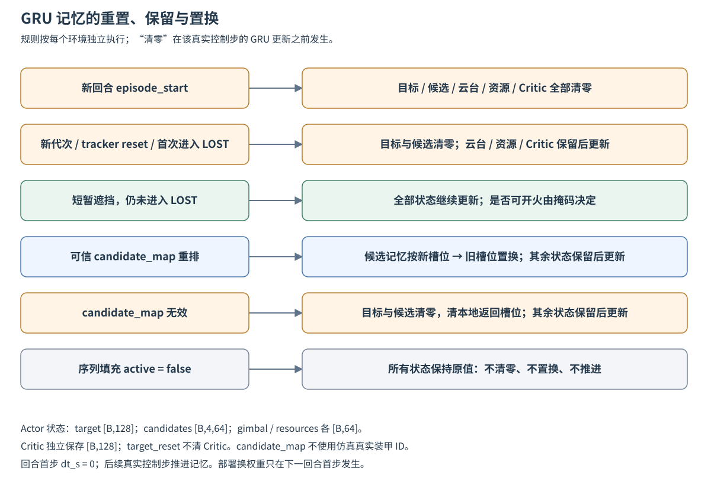

# 持续记忆 GRU

策略 `asymmetric_gru` 使用观测模式 `asymmetric_gru_v1`、schema v5。v4 的 126 个合法字段、单位、坐标与 softsign 归一化保持不变，时间轴从 `[8,126]` 改为当前 `[126]`。字段说明见 [v4 契约](asymmetric_observations.md)。旧 MLP 配置和检查点继续使用原加载器；GRU 从头训练。

## 运行分工与时间

服务器运行仿真、视觉估计、Actor 推理、完整回合采集、Critic 估值、PPO 更新和模型导出。NUC 只接收导出的 Actor，在本机推理并维护状态。`src.training.split` 不用于 GRU。

每个控制步为 **10 ms**，GRU 每步推进一次。共享 `dt_s` 为相邻观测实际经过的秒数，回合首步为 0，网络使用 `dt/(0.1+dt)`。仿真以物理时间计算，实车接口使用单调时钟。50–100 ms 是独立的射击机会间隔。开火计时仅供资源 GRU 和开火头读取。

## 单步与状态接口

| 输入 | 无批次形状 | 含义 |
| --- | --- | --- |
| `features` | 126 | v4 白名单当前帧编码，仍只保留冷却增益 |
| `valid` | 1 | 当前适配器数据有效标记；目标状态另在 features 中 |
| `action_mask` | 9 | Actor 已知信息及本地计时生成的合法动作 |
| `selection_memory` | 5 | 上一个不同的确认槽位，按 -1、0、1、2、3 独热编码 |
| `decision_clock` | 5 | due、等待秒数、配置最短/最长间隔、回合固定间隔；网络再 softsign |
| `dt_s` | 1 | 实际秒数，首步 0 |
| `episode_start` / `target_reset` | 各 1 | 重置事件，不包含跟踪代次编号 |
| `candidate_map` | 4 | 新槽位对应的旧槽位，必须为 0…3 的排列 |
| `privileged` | 3136 | 仅训练 Critic 使用的当前仿真真值 |

`RecurrentObservationPolicy` 是训练和仿真部署共同的逐步适配器。真实设备调用 `LiveObservationAdapter.observe`，提供视觉估计、自身反馈与跟踪元数据，不提供仿真位置。反馈时间戳必须来自同一个单调时钟。目标 LOST 时照常编码 IMU、热量、额度、冷却和请求信息，动作仍按有限预测与禁射规则处理。

实车调用方管理回合边界与请求历史。若启用现有 `DecisionClock`，在回合重置及预热结束后调用 `adapter.clock.start_episode()`，每个成功完成的 10 ms 控制周期后调用 `adapter.clock.complete_step()`，与仿真环境一致；`observe` 自身只产生一次当前观测及实际经过的 `dt_s`。

Actor 状态按 `(target, candidates, gimbal, resources)` 排列，批次形状分别为 `[B,128]`、`[B,4,64]`、`[B,64]`、`[B,64]`。四个候选共用编码器、GRU 和评分头，各自保存状态。候选集合用合法选板掩码做平均，不读取开火掩码。资源 GRU 只读自身资源与请求计时，目标上下文在开火头融合。

新回合清全部状态；目标跟踪器 reset、新 generation，或从非 lost 状态首次进入完整 LOST 时，清目标与候选状态。短暂遮挡但仍保留跟踪/预测状态时继续更新。当前视觉跟踪器在同一代次内保持槽位身份，代次重建时重新初始化。上游若确认重排，可提供 `candidate_map`；映射不可信时清目标组，同时清本地返回槽位。绝不使用仿真真实装甲 ID。每个环境单独保存状态，序列填充步既不清零、置换，也不推进状态。

Critic 使用独立的 128 维 GRU 编码 Actor 合法观测及重置/映射上下文，与 `[256,128]` 当前真值编码拼接，再经 `[128,128]` 输出价值。目标重置不会清 Critic，只有回合边界会。其梯度与隐藏状态不进入 Actor。

## 状态生命周期



图 2：重置、置换和真实步更新是不同操作。目标组重置保留云台、资源和 Critic 记忆；新回合清全部记忆。填充步保持原状态，即使填充输入含重置标记或槽位映射，也不执行这些操作。短暂遮挡与进入完整 LOST 的处理不同。

依据：[输入适配器](../src/policy/recurrent_observations.py)、[Actor 状态更新](../src/policy/recurrent_actor.py)、[Critic 状态更新](../src/training/recurrent_policy.py)。[Mermaid 图源](figures/gru_lifecycle.mmd)。

## 完整回合 PPO

四份课程预设均为 128 个工作进程，每个至少采集 512 步后完成当前回合并暂停。全部进程暂停后统一优化；下一批回合才使用新权重。不会在回合中途换模型或自动重置已暂停进程。每个环境仍拥有独立仿真、桥接、场景随机流和日志。

序列长度 128、预热最多 32 步、小批次 64 个片段、10 epochs。片段不跨回合，内部保持顺序。每个 epoch 用当前参数无梯度重放完整回合，缓存预热起点状态；小批次先预热，再执行截断反向传播。epoch 内后续参数更新会令缓存近似过时，逐 epoch 刷新、预热和 KL 0.03 限制用于控制误差。

学习率 3e-4、gamma 0.999、GAE lambda 0.99、clip 0.2、entropy 0.01、value 0.5、梯度裁剪 0.5。行为 log probability、旧价值、优势和回报在一批更新中固定。优势归一化只统计真实训练样本；预热与填充不参与损失。动作保留原采样值和联合概率，执行动作、接受/拒绝请求、实际发弹另存日志。

真正终止自举为 0；时间截断用同一回合最终观测及该回合 Critic 状态计算价值。最后一发额度耗尽后，环境仍等待待发请求和在途弹丸结算。回合末观测保存在 rollout 中，不借用 reset 后的下一回合数据。

检查点 ZIP 包含 `rmvision.json` 与 `recurrent.pt`，保存配置、契约、参数、优化器、训练计数和随机流。恢复训练从新回合与零隐藏状态开始。长期运行每批最多抽样八条完整轨迹，`rollouts/update-*/` 保存诊断回合观测、采样动作、原始概率、奖励、终止/截断、GAE 和执行记录；`episodes/`、`logs/` 沿用 CSV、奖励流和 TensorBoard 日志。

## 构建与训练命令

从 `rm_vision_rl` 根目录运行，安装 `requirements-training.txt`；服务器使用支持其 GPU 的 CUDA PyTorch。

```bash
(cd ../rm_simulator_2027 && cargo build --release --features training --bin daedalus_training)
cmake -S native/vision_bridge -B artifacts/build/vision-bridge \
  -DVISION_ROOT="$(realpath ../rm_vision_2027)" -DCMAKE_BUILD_TYPE=Release
cmake --build artifacts/build/vision-bridge -j 8
python -m unittest discover -s tests -v

# 默认步兵 v2。
python -m src.training.train --output-dir artifacts/training/infantry-v2
# 哨兵 v2。
python -m src.training.train --config config/training/rmul_2027_sentry_curriculum_v2.json \
  --output-dir artifacts/training/sentry-v2
# 课程恢复保留原累计预算与环境数，不追加预算。
python -m src.training.train --resume artifacts/training/infantry-v2/latest.zip \
  --output-dir artifacts/training/infantry-v2-resume
```

仓库提供步兵、哨兵各自的课程 v2/v3 配置；上述命令使用 v2。四份预设均使用单 GPU `cuda:0`、128 环境、各累计十亿步、随机种子 17。
两种角色分别训练和保存，模型结构一致，物理资源预设独立。没有多 GPU 同步。
`--device cpu` 可用于本地功能检查；短资格验证使用 `tools.training.curriculum_v2 benchmark`，
运行方法和全部课程设置见 [课程 v2](curriculum_training_v2.md)。

旧 MLP/非课程 GRU 的新训练预设已移除。`tools.training.recurrent_compare` 仅保留作为
已有 GRU Actor 与已有 MLP 检查点的历史对照工具，不据此判断 v2 课程是否通过。
当前课程评估采用冻结场景、逐阶段门槛和独立最终测试集。

## NUC 部署

训练结束自动生成 `actor/actor.pt` 和 `actor/manifest.json`，只包含 Actor。清单记录字段单位、归一化、形状、网络版本和 SHA256，不包含 Critic 参数、优化器或训练器。复制整个 Actor 目录到 NUC 的新版本目录，保留旧模型。

导出时用最后一个真实回合比较训练 Actor 与 TorchScript 的逐步概率、确定性动作和隐藏状态，结果写入 `export-verification.json`。已有检查点也可重新导出到新目录，并指定保存的回合进行核对：

```bash
python -m tools.training.recurrent_export --checkpoint artifacts/training/infantry-v2/final.zip \
  --output artifacts/deployment/infantry-v2 \
  --trajectory artifacts/training/infantry-v2/rollouts/update-00000005/episode-0000.npz
```

`update-00000005` 仅为示例，使用该次训练实际保存的回合路径。

```bash
python -m tools.training.recurrent_deploy --actor artifacts/deployment/infantry-v2 \
  --episodes 2 --output artifacts/deployment-check/infantry-v2
```

纯推理 API：`ActorRunner(path).predict(actor_observation)`，返回动作、五种选板概率、四种条件开火概率。调用者不提供 Critic 真值，每个真实控制步调用一次。`request_model(new_path)` 先验证文件，下一回合首步才换权重并清状态。重启部署会话必须从回合边界开始。TorchScript 原始接口为 `(Dict[str,Tensor], ActorState) -> (selection, fire, action, ActorState)`，重置与映射包含在输入字典中。

部署闭环记录预热 100 步后的 CPU 推理延迟，包含输入转换、网络、状态更新和输出处理；目标为 P99 ≤ 10 ms。该数值不包含视觉和物理仿真耗时。`LiveObservationAdapter` 定义实车等价输入边界，串口链路和固件接入仍待实现；课程、热锁奖励和长期训练见[课程 v2](curriculum_training_v2.md)；v3 的校准与发布要求见[课程 v3](curriculum_training_v3.md)。


实现入口：[输入适配](../src/policy/recurrent_observations.py)、[Actor](../src/policy/recurrent_actor.py)、[Critic](../src/training/recurrent_policy.py)、[循环 PPO](../src/training/recurrent_ppo.py)、[部署](../src/policy/recurrent_deployment.py)。超参数以实际运行保存的 config 为准；上文数值对应仓库课程预设。
